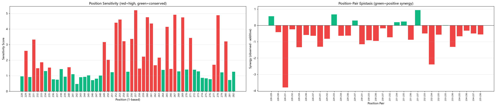
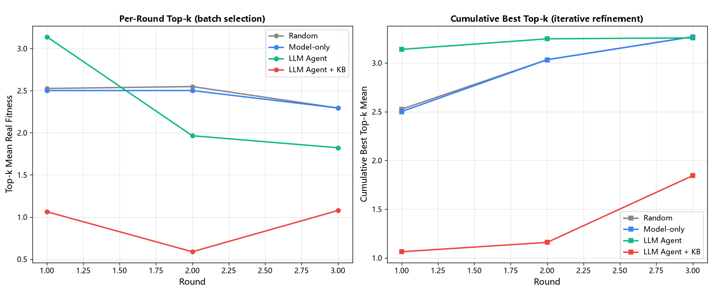
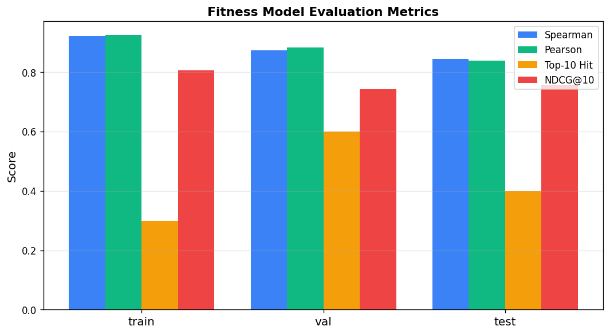
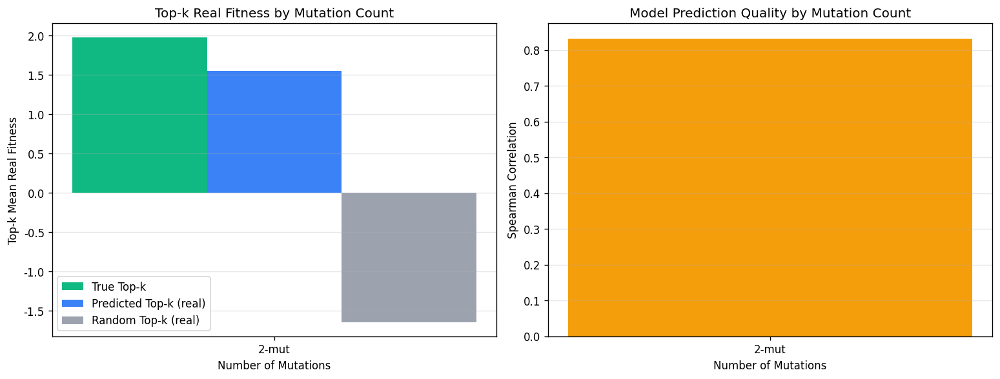
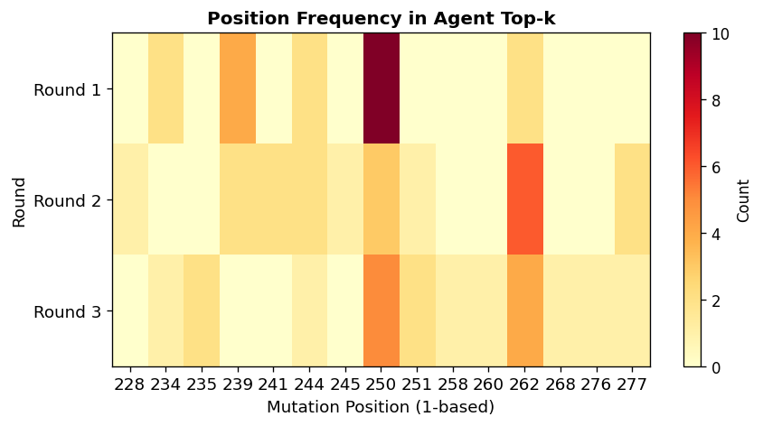
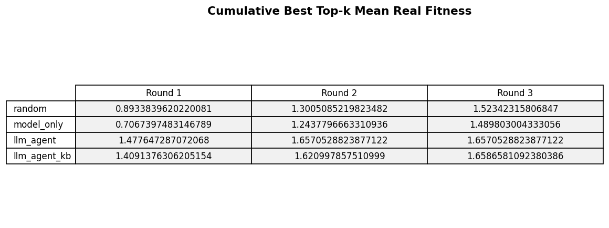

## Overview

基于ProteinGym GB1 DMS 数据（53.7 万条），训练 4-base Stacking 集成适应度预测模型，设计LLM Agent模拟科学家定向进化流程，结合三层知识库增强，通过四种方法三轮对比实验和闭环DBTL迭代验证Agent价值。

## Environment

- Python ≥ 3.9
- Dependency：see `requirements.txt`
- Install：`pip install -r requirements.txt`

---

## Run

```bash
python main.py              # 全流程：下载→处理→训练→演示→对比→图表
python main.py train        # 仅训练
python main.py demo         # Agent演示
python main.py compare      # 对比实验
python main.py closed-loop -a ucb   # 闭环DBTL
python main.py zeroshot     # ESM-2零样本评估
python main.py conservation # 保守位点分析
python main.py interactive  # 交互式demo
```

## Dataset

### 来源

ProteinGym 的 GB1 数据集（Olson et al. 2014, eLife）

- 文件：`SPG1_STRSG_Olson_2014.csv`
- 字段：`mutant`（如 `Q228R:T279L`）, `DMS_score`（fitness）, `DMS_score_bin`
- 总量：536962 条
- 野生型：全长蛋白G（448aa），突变区域 228-280（GB1 domain，53aa）
- 突变位点：29 个（228-281范围，全长蛋白编号）
- 突变类型：单点（1045条）+ 双点（535917条）

### 数据划分

按突变位点pair分组划分，训练/测试位点pair不重叠：
- 训练集：4002 条
- 验证集：612 条
- 测试集：603 条

---

## Fitness prediction model

### features

每个突变编码为 2659 维特征向量：

| 特征 | 维度 | 说明 |
|------|------|------|
| BLOSUM62 | 448 | 每个位置的替换得分 |
| One-hot | 580 | 29位点×20氨基酸 |
| 理化性质 | 6 | 疏水性/电荷/大小/极性/保守性/异常 |
| 位点交互 | 1625 | 突变数+406对位点的4种交互信号 |

### Model

- RandomForest（500棵树, max_depth=10）
- XGBoost（500棵树, max_depth=5）
- GradientBoosting（300棵树, max_depth=4）
- Ridge（线性基线）
- 元模型：RidgeCV

### Performance

| 指标 | Train | Val | Test | CV(5-fold) |
|------|-------|-----|------|-----------|
| Spearman | 0.922 | 0.873 | **0.845** | 0.863±0.019 |
| Top-10 Hit | 0.300 | 0.600 | 0.400 | - |
| NDCG@10 | 0.805 | 0.742 | 0.757 | - |

---

## Results

### 1. 保守位点分析

<div align="center">
  
  <p>图 1：蛋白质突变位点的保守性分析结果</p>
</div>

### 2. 多轮 Fitness优化

<div align="center">
  
  <p>图 2：多轮迭代过程中 Fitness 的变化趋势</p>
</div>

### 3. 模型性能评估

<div align="center">
  
  <p>图 3：Fitness 预测模型的性能评估结果</p>
</div>

### 4. 不同突变数量的效果对比

<div align="center">
  
  <p>图 4：单点、双点及多点突变的优化效果对比</p>
</div>

### 5. 突变位点热力图

<div align="center">
  
  <p>图 5：不同蛋白质突变位点的分布及相关指标热力图</p>
</div>

### 6. Top-k 候选突变结果

<div align="center">
  
  <p>图 6：科学智能体筛选出的 Top-k 候选突变及其预测结果</p>
</div>


---


## Reference

- [EvolvePro](https://github.com/mat10d/EvolvePro) ([bioRxiv 2024](https://www.biorxiv.org/content/10.1101/2024.07.17.604015v1))
- [ProteinGym](https://github.com/OATML-Markslab/ProteinGym) ([NeurIPS 2023](https://proceedings.neurips.cc/paper_files/paper/2023/file/cac723e5ff29f65e3fcbb0739ae91bee-Paper-Datasets_and_Benchmarks.pdf))
- [ESM](https://github.com/facebookresearch/esm) ([Science 2023](https://www.science.org/doi/10.1126/science.ade2574))
- [ProtAgents](https://github.com/lamm-mit/ProtAgents) ([arXiv 2024]([https://arxiv.org/abs/2402.04268](https://arxiv.org/abs/2402.04268)))

